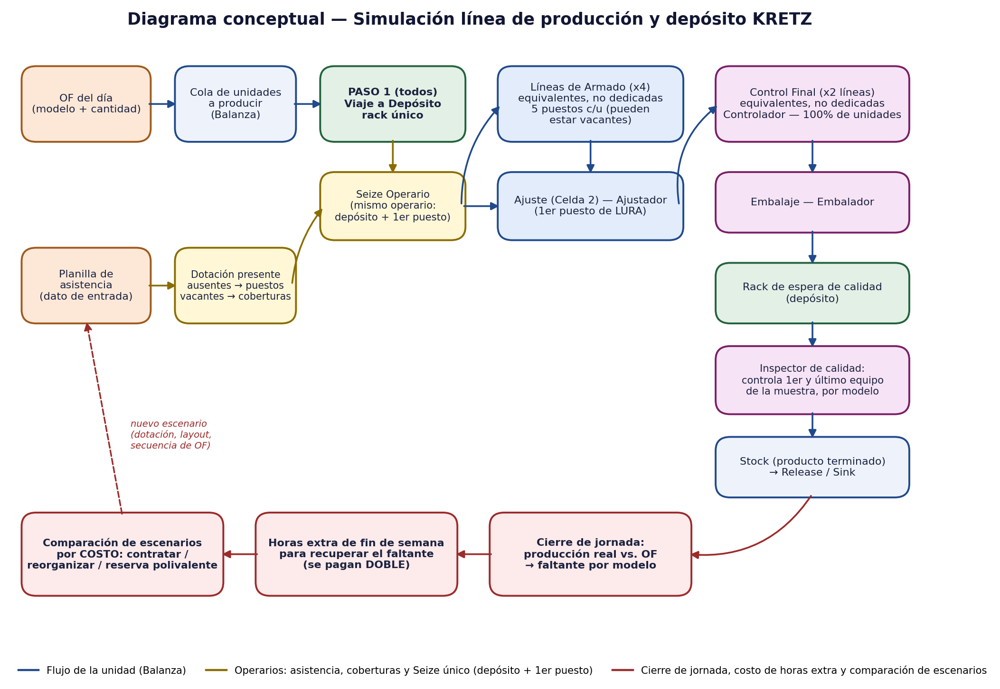
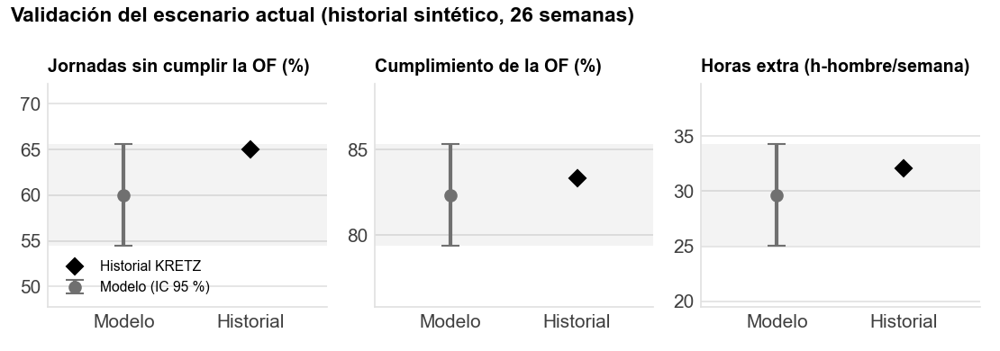
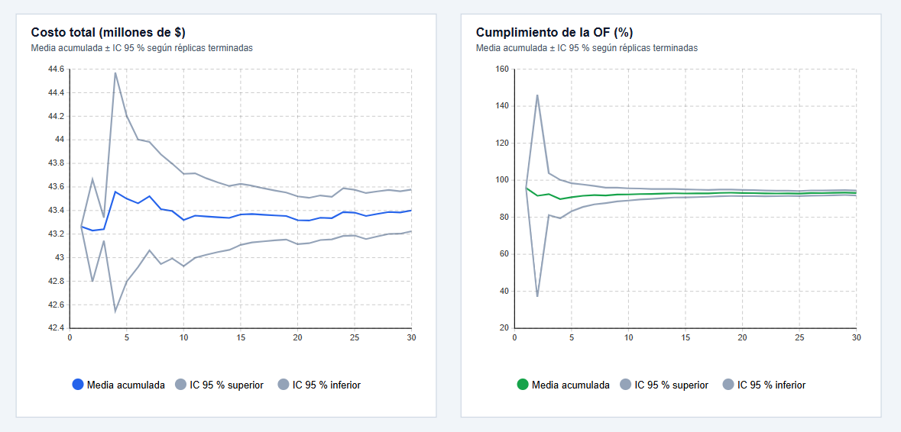
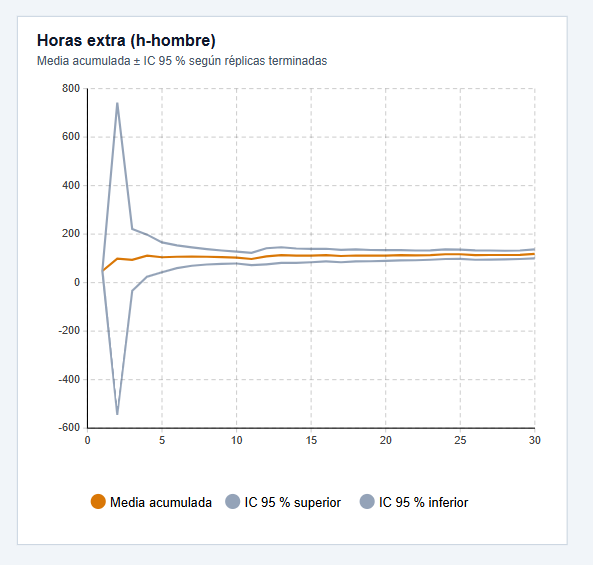
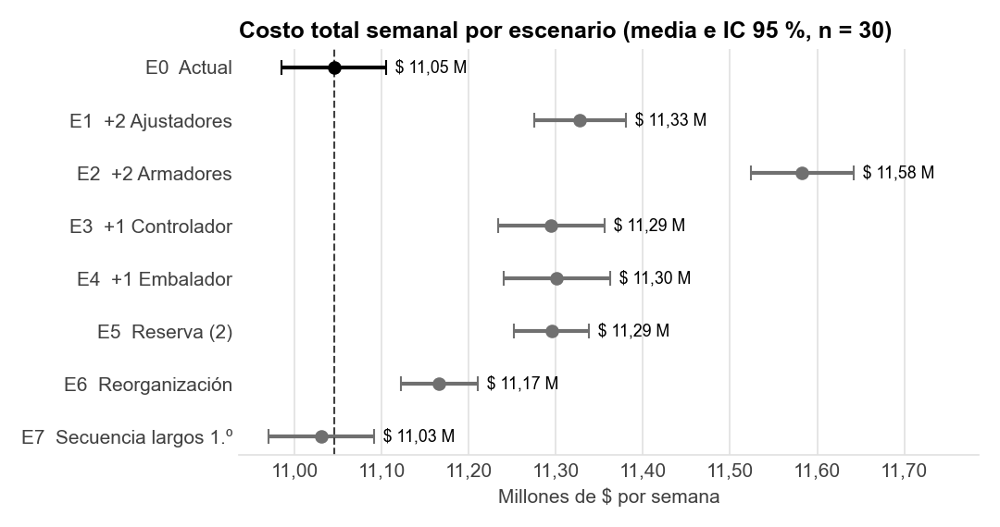
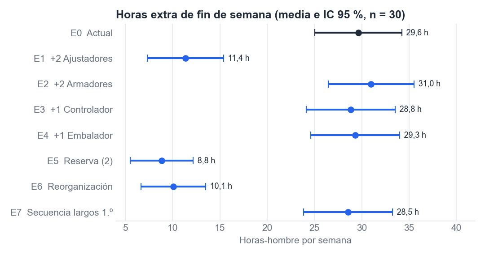
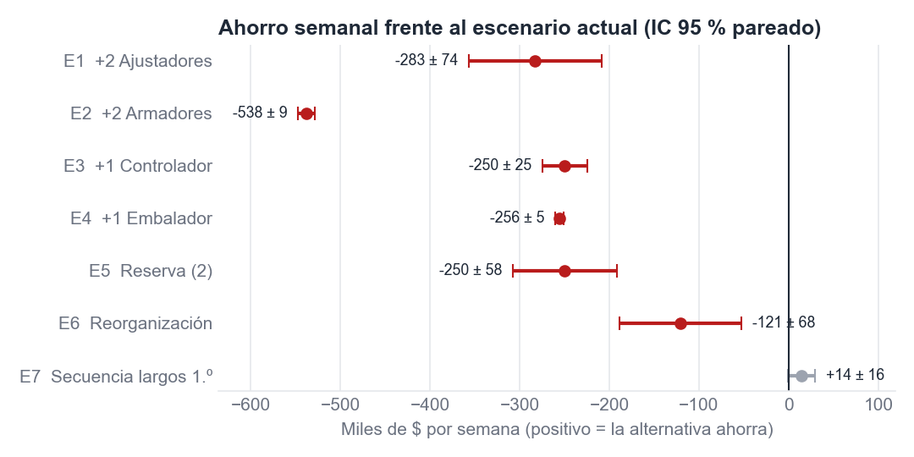
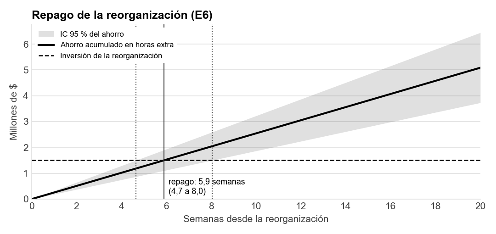

# Simulación de la línea de producción y el depósito de KRETZ: horas extra de fin de semana frente a contratación, reorganización y personal de reserva

**Trabajo Práctico Integrador de Simulación — Etapa 2/2 — Grupo 7**
[[COMPLETAR: autores y correos electrónicos]]

> Borrador en Markdown para pasar después a Overleaf. Las fórmulas están en sintaxis LaTeX (`$...$`) para copiarlas tal cual. Las figuras están en `Informe/figuras/` y los números salen de `Resultados/Resultados_KRETZ.xlsx` (240 corridas: 8 escenarios × 30 réplicas).

---

## Resumen

KRETZ, fabricante de balanzas, no cumple todos los días la Orden de Fabricación (OF) y recupera el faltante con horas extra los sábados, que se pagan al doble. Se construyó en AnyLogic un modelo de simulación de eventos discretos de la planta: 6 líneas, 5 modelos de balanza, viaje al depósito de materiales, ausentismo, coberturas, control de calidad por muestreo y recuperación de fin de semana. Con él se comparó en costo la situación actual contra siete alternativas: contratar personal de cuatro especialidades distintas, tener personal de reserva polivalente, reorganizar las líneas y cambiar la secuencia de fabricación. Cada escenario se corrió 30 veces con la misma lista de semillas (números aleatorios comunes), y las alternativas se compararon por pares de réplicas con intervalos de confianza del 95 %.

En el escenario actual la OF no se cumple en el 60 % de las jornadas y hay que trabajar el sábado en casi dos de cada tres semanas. El cuello de botella es el puesto de Ajuste, con una utilización del 92 %. La recuperación requiere 29,6 h-hombre de fin de semana por semana, con un costo de $ 385.147 por semana.

Ninguna contratación se paga sola. Un empleado cuesta lo mismo que 20 h-hombre de horas extra por semana, y la contratación más eficaz, la de 2 Ajustadores, ahorra en total 18,2 h-hombre por semana entre los dos. La reorganización (3 armadores + 2 ajustadores por línea, con coberturas entre especialidades) no agrega sueldos y baja las horas extra a 10,1 h-hombre por semana. Su ahorro operativo es de $ 254.243 por semana (IC 95 %: $ 186.392 a $ 322.095), así que recupera la inversión de $ 1.500.000 en unas 6 semanas (entre 4,7 y 8,0). Por eso es la alternativa que se recomienda.

**Palabras clave:** simulación de eventos discretos, AnyLogic, planificación de la producción, ausentismo, horas extra, números aleatorios comunes, intervalos de confianza.

---

## 1. Introducción

KRETZ produce balanzas comerciales e industriales en una planta de dos naves. En la nave de producción hay 4 líneas de Armado y 2 de Control Final, de 5 puestos cada una. En el depósito están el rack de materiales, el rack de espera de control de calidad y los racks de producto terminado. Las líneas no están dedicadas a un modelo: cualquier línea de Armado puede recibir cualquier equipo, y lo mismo vale para las de Control Final.

La producción de cada día sigue una Orden de Fabricación (OF) que indica qué equipos producir y en qué cantidad. Los tiempos de proceso registrados en SAP son promedios y en la práctica varían. A eso se suman las ausencias del personal y la cantidad limitada de puestos, así que hay jornadas en las que la OF no se cumple. Hoy la empresa recupera ese faltante con horas extra de fin de semana pagadas al doble, lo que representa un costo importante.

Un cálculo con tiempos medios no alcanza para estudiar el problema, porque los incumplimientos los provoca justamente la variabilidad. Un día con varias ausencias o con tiempos de tarea largos deja unidades sin terminar, aunque en promedio la capacidad alcance. Por eso se simuló el sistema con sus fuentes de variabilidad y se compararon las alternativas sobre muchas réplicas.

## 2. Objetivos

**Objetivo general.** Determinar, en términos de costo, si a KRETZ le conviene seguir recuperando el faltante con horas extra de fin de semana o adoptar alguna alternativa de dotación u organización.

**Objetivos específicos.**

1. Reproducir el funcionamiento de las jornadas de trabajo para medir con qué frecuencia no se cumple la OF y en qué equipos, puestos o especialidades se concentra el faltante.
2. Estimar las horas extra de fin de semana necesarias para recuperar el faltante y su costo.
3. Comparar el costo total de la situación actual con el de siete alternativas: contratar personal (Ajustadores, Armadores, Controlador o Embalador), tener personal de reserva polivalente, reorganizar los puestos de las líneas y cambiar la secuencia de fabricación.
4. Informar cada comparación con un intervalo de confianza que permita decir si la diferencia es estadísticamente significativa.

## 3. Metodología

### 3.1 Sistema y alcance

El modelo representa el recorrido de cada unidad de 5 modelos, elegidos como representativos de la carga de la planta: AILA 30KG, REPORT LT, NOVEL ECO, LURA y AURA. Cada unidad se libera según la OF del día y termina cuando pasa a stock, después del control de calidad.

Quedan fuera del alcance:

- los demás modelos que fabrica KRETZ;
- la cadena de abastecimiento: el rack de materiales siempre tiene stock;
- el despacho a clientes;
- las fallas de equipos;
- el retrabajo de las unidades rechazadas.

Los tres aspectos centrales que el modelo debía capturar son:

- **Viaje a depósito.** Antes de empezar un equipo, el operario que hará su primer puesto camina hasta el rack único de materiales, retira lo necesario (2 min según SAP) y vuelve a su puesto. En el rack pueden retirar hasta 5 personas a la vez. El tiempo de caminata forma parte del proceso.
- **Ausentismo y coberturas.** Al inicio de cada jornada se determina quién falta. El puesto del ausente queda vacante hasta que otro operario lo cubre dejando el suyo, de modo que la cobertura traslada el cuello de botella en lugar de eliminarlo.
- **Control de calidad por muestreo.** De la producción diaria de cada modelo, el inspector controla solo el primer y el último equipo.

### 3.2 Modelo conceptual

- **Entidades:** la balanza (unidad), con atributos de modelo, línea asignada, tiempos de inicio y fin y resultado de la inspección; la OF del día; la muestra de calidad por modelo.
- **Recursos:** los operarios, con una especialidad (Armador, Ajustador, Controlador o Embalador), un puesto habitual y un estado de asistencia; el rack de materiales (5 lugares); el inspector de calidad.
- **Dotación de línea del escenario actual:** 4 líneas de Armado con 4 armadores y 1 ajustador cada una, y 2 líneas de Control Final con 2 controladores y 3 embaladores cada una, en total 30 operarios de línea. A ellos se suman 10 empleados de depósito y 1 inspector, que entran solo en los costos.
- **Colas:** unidades liberadas esperando operario, retiro en el rack de materiales, colas por puesto (prioridad para la unidad más avanzada en su receta y, a igual etapa, para la liberada antes), rack de espera de calidad.
- **Eventos principales:**
  - inicio de jornada (OF y asistencia);
  - coberturas;
  - liberación de unidades;
  - llegada del operario al rack o al puesto;
  - fin de tarea;
  - ingreso al rack de calidad;
  - inspección;
  - cierre de jornada;
  - jornada de recuperación de fin de semana.

Las secuencias de puestos y los tiempos medios de cada modelo, relevados de SAP, se presentan en la Tabla 1.

**Tabla 1. Secuencia y tiempos medios por modelo (min). Todos empiezan con el retiro de materiales en el depósito (2 min).**

| Modelo | Armado | Ajuste / Ensamble | Control Final | Embalaje | Total sin caminata |
|---|---|---|---|---|---|
| AILA 30KG | 3,5 + 7 + 7 + 7,5 | 5 | 4,5 | 10 | 46,5 |
| REPORT LT | 11 | 12 | 12 | 12 | 49 |
| NOVEL ECO | 3,15 | 3 | 2,25 | 3 | 13,4 |
| LURA (importado, sin armado) | — | 4 | 3,15 | 3,15 | 12,3 |
| AURA | 3,15 | 3 | 2,5 | 2,88 | 13,53 |

### 3.3 Datos de entrada y supuestos

| Dato | Valor en el modelo | Fuente |
|---|---|---|
| Tiempos de tarea | Triangular con mínimo $0{,}8\,m$, moda $0{,}9\,m$ y máximo $1{,}3\,m$, donde $m$ es el tiempo de SAP (la media de la distribución es $m$) | SAP; asimetría supuesta: las demoras largas son más probables que las tareas muy cortas |
| Retiro de materiales | 2 min (misma triangular); hasta 5 operarios a la vez en el rack | SAP y planta |
| Jornada | Turno de 480 min, 5 jornadas por semana | KRETZ |
| Ausentismo | 6 % por empleado y día, con un factor por día de la semana (lunes 1,25; martes 1,0; miércoles y jueves 0,9; viernes 1,1); 10 % en la recuperación de fin de semana | Supuesto, coherente con la planilla de ausencias de referencia (Sección 3.5) |
| Velocidad de caminata | 1,3 m/s, en línea recta y pasando por la puerta entre naves | Valor típico de marcha; plano a escala (16 px = 1 m) |
| Inspección de calidad | 8 min por equipo inspeccionado; 3 % de rechazo | Supuesto |
| OF | OF 1, mezcla equilibrada, todos los días: 42 AILA 30KG, 58 REPORT LT, 83 NOVEL ECO, 55 LURA y 69 AURA (307 unidades) | KRETZ (OF de producción) |
| Costo de la hora normal | $ 6.500 por empleado, con cargas | Supuesto |
| Recargo de fin de semana | ×2 | KRETZ |
| Recuperación de fin de semana | Se convoca una cuadrilla proporcional al faltante: 1 persona cada 4 unidades pendientes, entre 3 y 12, repartidas entre especialidades según los minutos pendientes. Se pagan al menos 4 h y como máximo 16 h; lo que no se recupera pasa a la semana siguiente | Supuesto |

Supuestos principales:

- Los 5 modelos son representativos de la carga.
- El rack de materiales nunca se queda sin stock.
- La asistencia se define al inicio de la jornada.
- La jornada de fin de semana rinde por hora lo mismo que una jornada normal; solo cambia el costo.
- El operario que retira los materiales es siempre el que hace el primer puesto de la unidad.

**Coberturas.** En el escenario actual, una vacante se cubre con un operario de la misma especialidad que deja su propio puesto; los puestos críticos (Ajuste y Control) se cubren primero. Si hay personal de reserva, la reserva cubre primero los puestos críticos y después el resto, en el orden Ajuste, Control, Embalaje y Armado. Solo en la reorganización se habilitan las coberturas entre especialidades: cualquier operario de la misma línea puede cubrir un puesto vacante.

### 3.4 Construcción del modelo

El modelo se construyó en AnyLogic 8.9 (Personal Learning Edition) con la Process Modeling Library. Un único flujo atiende los 5 modelos. Cada unidad, en cada paso:

1. toma un operario de la especialidad requerida (*Seize*);
2. el operario camina hasta el puesto;
3. ejecuta la tarea (*Delay*);
4. libera al operario (*Release*).

El primer paso incluye el retiro en el rack, con el mismo *Seize* que el primer puesto, para que el operario que retira los materiales sea el que hace la primera tarea.

Las líneas equivalentes se resuelven con una regla de ruteo en la condición del *Seize*. Se elige un operario de un puesto apto en la línea ya asignada a la unidad, o en cualquier línea capaz de completar el equipo con el personal presente ese día.

Los operarios son agentes que se desplazan sobre el plano a escala. Se evaluó el uso de Pedestrian Library, que modela la caminata con paredes y obstáculos, pero la edición Personal Learning la limita a 5 horas de tiempo simulado, y cada réplica necesita 4 semanas. Por eso la caminata se calcula como distancia sobre velocidad, en línea recta y pasando por la puerta entre naves cuando el operario cambia de nave. En el escenario actual la caminata ocupa el 3,7 % del tiempo de trabajo de los operarios.

Al cierre de cada jornada se compara lo producido a tiempo con la OF. Las unidades atrasadas siguen en proceso y se terminan primero al día siguiente. Al cerrar el viernes, lo que sigue pendiente se procesa en la jornada de recuperación del sábado, y sus horas-hombre se valorizan al doble.

El modelo tiene tres pestañas: **Simulación** (animación 2D y 3D de la planta), **Variables** (tablero de indicadores) y **Gráficos**. Al terminar, cada corrida guarda una fila en `resultados_corridas.csv` y una por semana en `resultados_semanas.csv`.

### 3.5 Verificación y validación

**Verificación**:

- **Corridas con variabilidad nula** (`variabilidadTiempos = 0`) y sin ausencias. Se comparó el tiempo de proceso de una unidad aislada con la suma de los tiempos de la Tabla 1 más la caminata calculada a mano. [[COMPLETAR: resultado de la prueba]]
- **Seguimiento de unidades individuales** en la animación: retiro en el rack, recorrido de puestos, rack de calidad y stock.
- **Conservación:** unidades liberadas = terminadas + en proceso + pendientes, al cierre de cada semana.
- **Reproducibilidad:** dos corridas con la misma semilla dan exactamente los mismos resultados. Además, la planilla de resultados confirma que los 8 escenarios usaron las mismas 30 semillas.
- **Inspección:** solo el primer y el último equipo de cada modelo por día.
- **Coherencia de los indicadores.**
  - El efecto de las ausencias se mide comparando cada día de la semana consigo mismo, porque el atraso se acumula de lunes a viernes. En el escenario actual, una jornada con ausencias deja en promedio 46,8 ± 13,2 unidades más de faltante que el mismo día de la semana sin ausencias.
  - Las alternativas que agregan capacidad en el cuello de botella (Ajuste) son las que bajan el faltante, como se espera.

**Validación**: se comparó el escenario actual con un historial de referencia de 26 semanas (marzo a agosto de 2026, 120 jornadas): planilla de ausencias, OF diarias y horas extra de cada sábado (`Datos/Sinteticos/`).

> **Importante:** mientras KRETZ no entregue los registros completos, ese historial es **sintético**. Lo genera `scripts/generar_datos_sinteticos.py` con un modelo de capacidad más simple que el de AnyLogic, pero con los mismos tiempos de SAP, la misma tasa de ausentismo y el mismo valor de la hora. Por eso la comparación muestra que el modelo es coherente con esos supuestos, no que reproduce la planta real. Cuando lleguen los registros reales, alcanza con reemplazar esos archivos y volver a correr la planilla.

**Tabla 2. Validación del escenario actual.**

| Medida | Historial | Modelo: media (IC 95 %) | ¿Historial dentro del IC? |
|---|---|---|---|
| Jornadas sin cumplir la OF | 65,0 % | 60,0 % (54,4 % a 65,6 %) | Sí |
| Cumplimiento de la OF en el turno | 83,4 % | 82,3 % (79,4 % a 85,3 %) | Sí |
| Horas extra de fin de semana (h-hombre/semana) | 32,1 | 29,6 (25,0 a 34,2) | Sí |
| Costo de horas extra por semana | $ 417.250 | $ 385.147 ($ 325.165 a $ 445.128) | Sí |
| Semanas con recuperación | 65,4 % (17 de 26) | 62,5 % (75 de 120) | (proporción) |
| Especialidad que limita la jornada | Ajustador (69 de 78 jornadas sin cumplir) | Ajustador (utilización del 92 %) | Sí |

**Figura 1.** Escenario actual simulado (media e IC 95 %, banda celeste) frente al historial de referencia.

Las cuatro medidas cuantitativas del historial caen dentro del intervalo del 95 % del modelo, y los dos identifican al Ajuste como el cuello de botella. El historial queda cerca del borde superior del intervalo en jornadas sin cumplir y en horas extra: el modelo puede subestimar levemente el faltante. Queda pendiente la validación cara a cara con el personal de la planta: qué puestos se saturan y qué coberturas se hacen en la práctica. [[COMPLETAR]]

### 3.6 Medidas de desempeño

De cada réplica $i$ de un escenario se registran tres medidas de desempeño, que son las que responden directamente a la pregunta del estudio:

1. **Costo total semanal** $C_i$ ($ por semana). Suma las horas normales de toda la dotación (incluidas las contrataciones y la reserva), las horas extra de fin de semana al doble y el costo de la reorganización. Es la medida principal para decidir entre escenarios.
2. **Cumplimiento de la OF** $P_i$ (%): unidades terminadas dentro de la jornada sobre unidades pedidas, en el horizonte de la réplica.
3. **Horas extra de fin de semana** $H_i$ (horas-hombre por semana): horas necesarias para recuperar el faltante.

Como medidas complementarias, para explicar los resultados y no para elegir el escenario, se informan:

- la utilización de operarios por especialidad;
- el tiempo medio de espera en cola por tipo de puesto (cuellos de botella);
- el faltante por modelo;
- las coberturas por jornada;
- la fracción del tiempo de los operarios que se va en caminar.

### 3.7 Diseño de experimentos

**Escenarios.** Se compararon 8 escenarios (Tabla 3). Todos usan la misma OF, el mismo horizonte y los mismos datos de entrada; solo cambian los parámetros indicados.

**Tabla 3. Escenarios evaluados.**

| # | Escenario | Cambio respecto del escenario actual |
|---|---|---|
| E0 | Escenario actual | Dotación actual, faltante recuperado con horas extra de fin de semana |
| E1 | Contratar 2 Ajustadores | +2 Ajustadores |
| E2 | Contratar 2 Armadores | +2 Armadores |
| E3 | Contratar 1 Controlador | +1 Controlador |
| E4 | Contratar 1 Embalador | +1 Embalador |
| E5 | Personal de reserva | 2 operarios polivalentes que cubren ausencias de cualquier especialidad |
| E6 | Reorganización | 3 armadores + 2 ajustadores por línea de Armado (misma dotación total) y coberturas entre especialidades; costo de reorganización de $ 1.500.000, una sola vez |
| E7 | Cambio de secuencia | Se liberan primero los equipos con procesos más largos |

**Horizonte y tipo de simulación.** Es una simulación con horizonte finito (terminante). Cada réplica simula 4 semanas: 20 jornadas de 480 min más hasta 4 jornadas de recuperación de fin de semana. Cada réplica arranca con la planta vacía, igual que una semana real arranca sin unidades en proceso, por lo que no hace falta descartar un período de calentamiento.

**Réplicas y semillas.** Cada escenario se corre $n = 30$ veces. Para que las réplicas sean independientes, cada una usa una semilla distinta. Las semillas no se sortean en cada corrida: se generaron una vez, al azar, y quedan fijas en el modelo (función `semillaDeReplica`). La réplica $j$ usa la semilla $s_j$ en **todos los escenarios**:

$$\mathcal{S} = \{s_1, \dots, s_{30}\} = \{227904006,\ 443043868,\ 639572182,\ \dots,\ 976990827,\ 205282126\}$$

(la lista completa está en el Anexo y en la hoja *Pares* de la planilla).

Esto tiene tres consecuencias:

- **Independencia dentro de cada escenario.** Las 30 réplicas de un escenario usan semillas distintas, así que sus resultados $X_1, \dots, X_n$ son observaciones independientes e idénticamente distribuidas de la medida de desempeño.
- **Reproducibilidad.** Cualquier réplica se puede repetir exactamente con su semilla.
- **Comparación justa entre escenarios (números aleatorios comunes).** El modelo usa flujos de números aleatorios separados para cada fuente de variabilidad: ausencias de lunes a viernes, ausencias de fin de semana, tiempos de tarea y rechazos. Cada número sale de la semilla y de una clave fija, por ejemplo día y puesto para las ausencias, o modelo, unidad y paso para los tiempos. Así, en la réplica $j$ falta la misma gente el mismo día y cada unidad tarda lo mismo en cada paso en todos los escenarios, aunque un escenario consuma más o menos números que otro. Las diferencias entre escenarios se deben entonces a los cambios de dotación u organización, y no a que a un escenario le tocaron, por azar, días con más ausencias.

En AnyLogic, cada escenario tiene un experimento de Variación de parámetros que recorre el parámetro `replica` de 1 a 30, una corrida por réplica. Mientras corre, el experimento grafica la media acumulada de cada medida con su intervalo del 95 %, para ver cómo se estabiliza al sumar réplicas (Figuras 2 y 3).

**Figura 2.** Escenario actual: media acumulada ± IC 95 % del costo total (millones de $ por réplica de 4 semanas) y del cumplimiento de la OF, a medida que terminan las 30 réplicas.

**Figura 3.** Escenario actual: media acumulada ± IC 95 % de las horas extra (h-hombre por réplica de 4 semanas).

Cómo leer estas figuras:

- **Unidades.** Están **por réplica de 4 semanas**, no por semana. Los valores finales coinciden con los de la Tabla 4 multiplicados por 4: $ 44,18 M de costo, 82,3 % de cumplimiento y 118,5 h-hombre de horas extra.
- **Primeras réplicas.** Con 2 réplicas el cuantil $t_{1;\,0{,}025}$ vale 12,7, así que el intervalo es enorme. Por eso aparecen límites imposibles, como más de 100 % de cumplimiento u horas extra negativas: no son errores del modelo.
- **Estabilización.** Desde unas 15 réplicas la media acumulada casi no se mueve y el intervalo se angosta lentamente, como $1/\sqrt{n}$.
- **Escala del eje.** AnyLogic ajusta solo la escala vertical de cada gráfico. Para comparar escenarios entre sí hay que usar las Figuras 4 a 6, que tienen un eje común.

**Cantidad de réplicas.** Con las réplicas del escenario actual se estimó cuántas hacen falta para estimar la media del costo total semanal con un error relativo $\varepsilon$:

$$n \ge \left( \frac{t_{n-1;\,\alpha/2}\, S}{\varepsilon\, \bar{X}} \right)^2 = \left( \frac{2{,}045 \times 160.634}{0{,}01 \times 11.045.147} \right)^2 \approx 9 .$$

Con un error del 1 % alcanzan 9 réplicas, porque las horas normales son fijas y solo varía la parte de horas extra. Si se mide la precisión sobre el costo de las horas extra solo, que varía mucho de una réplica a otra, harían falta unas 290 réplicas para un ±5 %. Sin embargo, la decisión no depende de esa precisión: con las 30 réplicas emparejadas, todas las diferencias de costo contra el escenario actual resultaron significativas, salvo la del cambio de secuencia (Sección 4.3). Se mantuvo $n = 30$ como mínimo para que la aproximación del Teorema Central del Límite sea razonable.

### 3.8 Análisis estadístico

**Intervalo de confianza para la media de cada escenario.** Sea $X_1, \dots, X_n$ la medida de desempeño (por ejemplo, el costo total semanal) en las $n$ réplicas de un escenario. Las réplicas son independientes porque cada una usa una semilla distinta, y tienen la misma distribución porque corren el mismo modelo con los mismos parámetros. Se calculan la media y el desvío muestrales:

$$\bar{X} = \frac{1}{n}\sum_{i=1}^{n} X_i, \qquad S = \sqrt{\frac{1}{n-1}\sum_{i=1}^{n}\left(X_i - \bar{X}\right)^2}.$$

Por el Teorema Central del Límite, para $n$ grande la media muestral se distribuye aproximadamente normal, $\bar{X} \sim N\!\left(\mu, \sigma^2/n\right)$, sea cual sea la distribución de cada $X_i$. Como $\sigma$ se estima con $S$, el estadístico estandarizado sigue aproximadamente una $t$ de Student con $n-1$ grados de libertad (que para $n = 30$ ya es casi una normal estándar: $t_{29;\,0{,}025} = 2{,}045$ frente a $z_{0{,}025} = 1{,}96$):

$$T = \frac{\bar{X} - \mu}{S/\sqrt{n}} \sim t_{n-1}.$$

Entonces $P\left(-t_{n-1;\,\alpha/2} \le T \le t_{n-1;\,\alpha/2}\right) = 1 - \alpha$, y despejando $\mu$ se obtiene el intervalo de confianza:

$$\mu \in \left[\, \bar{X} - t_{n-1;\,\alpha/2}\,\frac{S}{\sqrt{n}} \; ; \; \bar{X} + t_{n-1;\,\alpha/2}\,\frac{S}{\sqrt{n}} \,\right].$$

**Comparación entre escenarios.** Para comparar una alternativa $k$ con el escenario actual se usa el ahorro de cada réplica. Como las dos corridas de la réplica $j$ usan la misma semilla $s_j$, se pueden emparejar:

$$D_j = C_j^{(E0)} - C_j^{(k)}, \qquad j = 1, \dots, n.$$

Las $D_j$ son independientes entre sí, porque cada par usa una semilla distinta, así que se aplica el mismo procedimiento. El intervalo del ahorro medio es

$$\bar{D} \pm t_{n-1;\,\alpha/2}\,\frac{S_D}{\sqrt{n}}.$$

- Si el intervalo no contiene el cero, la diferencia es significativa al 95 %.
- Si está entero por encima del cero, la alternativa ahorra; si está entero por debajo, cuesta más.

Las dos corridas de cada par comparten la semilla, así que sus resultados están correlacionados positivamente. Por eso $S_D$ es mucho menor que el desvío de cada escenario. Por ejemplo, para la contratación de un Embalador $S_D = \$\,12.474$, frente a $S = \$\,160.634$ del escenario actual. Así, los intervalos de las diferencias son mucho más angostos con la misma cantidad de réplicas.

Como se hacen 7 comparaciones contra el escenario actual, cada una al 95 %, se informa además si la conclusión se mantiene con la corrección de Bonferroni: un nivel del $1 - 0{,}05/7 \approx 99{,}3\,\%$ por comparación, para un nivel conjunto del 95 %.

Todos los cálculos están en `Resultados/Resultados_KRETZ.xlsx` como fórmulas de Excel. Las hojas son:

- *Resumen*: medias e intervalos;
- *Pares*: diferencias réplica a réplica;
- *Equilibrio*: punto de equilibrio y repago;
- *Validacion*;
- los datos crudos de cada corrida.

También se reproducen con `scripts/analizar_resultados.py`.

## 4. Resultados

### 4.1 Escenario actual

Con la dotación actual y la OF de 307 unidades, la planta entrega a tiempo el 82,3 % de lo pedido (IC 95 %: 79,4 % a 85,3 %). La OF no se cumple en el 60,0 % de las jornadas (54,4 % a 65,6 %), es decir, en tres de cada cinco días.

El cuello de botella es claramente el **Ajuste**:

- **Utilización por especialidad:**
  - Ajustadores: 92,4 %;
  - Controladores: 76,8 %;
  - Embaladores: 62,2 %;
  - Armadores: 41,0 %.
- **Espera media en cola hasta conseguir un ajustador:** 165,1 min, frente a 25,8 min en armado y menos de 14 min en control y embalaje.

Hay un solo ajustador por línea, así que cuando falta uno, otro tiene que repartirse entre dos líneas y la producción del día cae. Una jornada con ausencias deja en promedio 46,8 unidades más de faltante que el mismo día de la semana sin ausencias.

El faltante se concentra en los modelos que la OF libera al final, porque las unidades se liberan en el orden de la OF. Por réplica de 4 semanas, faltan:

- AURA: 595 unidades;
- NOVEL ECO: 259;
- LURA: 187;
- REPORT LT: 42;
- AILA 30KG: casi nada (1,5).

Para recuperarlo hacen falta 29,6 h-hombre de fin de semana por semana (IC 95 %: 25,0 a 34,2), con un costo de $ 385.147 por semana. Hubo que convocar al personal el sábado en 75 de las 120 semanas simuladas (62,5 %). En todos los escenarios, la recuperación del sábado alcanzó para terminar lo pendiente: no quedó faltante sin recuperar.

### 4.2 Medidas de desempeño por escenario

**Tabla 4. Media e intervalo de confianza del 95 % ($\bar{X} \pm t_{29;\,0{,}025}\,S/\sqrt{n}$, $n = 30$). Valores por semana.**

| Escenario | Costo total semanal ($) | Cumplimiento de la OF | Jornadas sin cumplir | Horas extra (h-hombre/semana) | Semanas con sábado |
|---|---|---|---|---|---|
| E0 Actual | 11.045.147 ± 59.982 | 82,3 % ± 3,0 % | 60,0 % ± 5,6 % | 29,6 ± 4,6 | 62,5 % |
| E1 +2 Ajustadores | 11.327.791 ± 52.473 | 94,2 % ± 1,5 % | 36,0 % ± 4,1 % | 11,4 ± 4,0 | 33,3 % |
| E2 +2 Armadores | 11.582.778 ± 58.801 | 82,4 % ± 2,9 % | 61,5 % ± 4,9 % | 31,0 ± 4,5 | 65,8 % |
| E3 +1 Controlador | 11.294.813 ± 61.029 | 83,0 % ± 3,0 % | 54,7 % ± 5,6 % | 28,8 ± 4,7 | 59,2 % |
| E4 +1 Embalador | 11.300.927 ± 60.960 | 82,9 % ± 2,9 % | 57,2 % ± 5,7 % | 29,3 ± 4,7 | 61,7 % |
| E5 Reserva (2) | 11.294.923 ± 43.251 | 95,0 % ± 1,2 % | 26,7 % ± 4,7 % | 8,8 ± 3,3 | 24,2 % |
| E6 Reorganización | 11.165.903 ± 44.231 | 94,9 % ± 1,3 % | 33,8 % ± 4,3 % | 10,1 ± 3,4 | 30,0 % |
| E7 Secuencia largos primero | 11.030.952 ± 60.905 | 83,7 % ± 3,0 % | 60,7 % ± 5,8 % | 28,5 ± 4,7 | 65,0 % |

En E6, el costo total incluye la reorganización completa ($ 1.500.000) dentro de las 4 semanas de la réplica, es decir $ 375.000 por semana. Ese costo se paga una sola vez; ver la Sección 4.3.

**Figura 4.** Costo total semanal por escenario: media e intervalo del 95 %. La línea punteada es la media del escenario actual.

**Figura 5.** Horas extra de fin de semana por escenario: media e intervalo del 95 %.

Las Figuras 4 y 5 muestran dos grupos bien separados:

- **Bajan las horas extra a la tercera parte:** E1, E5 y E6, entre 8,8 y 11,4 h-hombre por semana. Sus intervalos no se solapan con el del escenario actual. Son las tres alternativas que agregan capacidad de Ajuste.
- **Casi no cambian las horas extra:** E2, E3, E4 y E7, entre 28,5 y 31,0 h-hombre por semana, con intervalos solapados con el del escenario actual.

En costo total, el único escenario que queda a la altura del actual es E7. Todos los demás quedan a la derecha, es decir, cuestan más.

### 4.3 Ahorro neto frente al escenario actual

**Tabla 5. Ahorro medio por semana ($\bar{D} \pm t_{29;\,0{,}025}\,S_D/\sqrt{n}$, pares con la misma semilla). Un valor negativo indica que la alternativa cuesta más.**

| Alternativa | Ahorro medio ($/semana) | IC 95 % | ¿Significativo al 95 %? | ¿Y con Bonferroni (99,3 %)? |
|---|---|---|---|---|
| E1 +2 Ajustadores | −282.644 | [−356.927 ; −208.362] | Sí, cuesta más | Sí |
| E2 +2 Armadores | −537.631 | [−546.997 ; −528.265] | Sí, cuesta más | Sí |
| E3 +1 Controlador | −249.666 | [−274.420 ; −224.912] | Sí, cuesta más | Sí |
| E4 +1 Embalador | −255.781 | [−260.438 ; −251.123] | Sí, cuesta más | Sí |
| E5 Reserva (2) | −249.777 | [−307.612 ; −191.942] | Sí, cuesta más | Sí |
| E6 Reorganización (con la inversión en 4 semanas) | −120.757 | [−188.608 ; −52.905] | Sí, cuesta más | Sí |
| E7 Secuencia largos primero | +14.194 | [−1.327 ; +29.715] | No | No |

**Figura 6.** Ahorro semanal de cada alternativa frente al escenario actual (intervalo del 95 % pareado). Rojo: cuesta más; gris: diferencia no significativa.

**Por qué no conviene contratar.**

- Un empleado contratado cuesta $40\ \text{h} \times \$\,6.500 = \$\,260.000$ por semana.
- Una hora extra de fin de semana cuesta $\$\,13.000$.
- Por lo tanto, una contratación se paga sola solo si ahorra al menos **20 h-hombre de horas extra por semana**.

El escenario actual paga 29,6 h-hombre por semana, así que en teoría una contratación podría pagarse, pero tendría que eliminar dos tercios de todas las horas extra por sí sola. La simulación muestra que no pasa:

- **2 Ajustadores**, que atacan el cuello de botella, bajan las horas extra de 29,6 a 11,4 h-hombre. Son 18,2 h-hombre entre los dos, unas 9 por persona. Ahorran $ 237.356 por semana y cuestan $ 520.000.
- **Armadores, Controlador o Embalador** no son el cuello de botella. Agregan sueldos y las horas extra no cambian de forma apreciable. Con 2 armadores más, las horas extra incluso suben un poco (31,0), porque llegan más unidades a la cola de Ajuste.

**La reorganización se paga en unas 6 semanas.** E6 no cambia la dotación total ni los sueldos: pasa a 3 armadores y 2 ajustadores por línea y habilita las coberturas entre especialidades. Su único costo extra es la inversión de $ 1.500.000, que en la réplica de 4 semanas se carga entera y la hace parecer más cara en la Tabla 5. Si se separa el ahorro operativo, la diferencia pareada en el costo de horas extra es la siguiente:

$$\bar{D}_{HE} = \$\,254.243 \text{ por semana} \quad (\text{IC 95 \%: } \$\,186.392 \text{ a } \$\,322.095),$$

y el tiempo de repago de la inversión es

$$\frac{\$\,1.500.000}{\$\,254.243/\text{semana}} \approx 5{,}9 \text{ semanas} \quad (\text{entre } 4{,}7 \text{ y } 8{,}0 \text{ semanas}).$$

**Figura 7.** Ahorro acumulado en horas extra de la reorganización frente a la inversión de $ 1.500.000. La banda es el IC 95 % del ahorro semanal pareado.

En un año de 48 semanas hábiles, el ahorro neto esperado es de $48 \times 254.243 - 1.500.000 \approx \$\,10{,}7$ millones. Además, la reorganización lleva el cumplimiento de la OF al 94,9 % y la frecuencia de sábados de 62,5 % a 30 % de las semanas. Es el mismo nivel que con 2 Ajustadores o 2 operarios de reserva, pero sin sumar sueldos.

En las capturas del experimento de réplicas de la reorganización (Anexo), la media acumulada termina en $ 44,66 M por réplica, 94,9 % de cumplimiento y 40,3 h-hombre de horas extra por réplica (10,1 por semana), coherente con la Tabla 4.

**La secuencia no cambia el resultado.** Liberar primero los equipos de proceso largo ahorra en promedio $ 14.194 por semana, pero el intervalo incluye el cero: con 30 réplicas no se puede afirmar que ahorre. El cumplimiento (83,7 %) es el mismo que el actual. Lo que cambia es qué modelos quedan atrasados:

- baja el faltante de AURA, de 595 a 202 unidades por réplica;
- sube el de NOVEL ECO (de 259 a 353), LURA (de 187 a 379) y AILA 30KG (de 1,5 a 55).

### 4.4 Medidas complementarias

**Tabla 6. Utilización, espera en cola y coberturas (media de las 30 réplicas).**

| Escenario | Util. Armador | Util. Ajustador | Util. Controlador | Util. Embalador | Espera media en ajuste (min) | Espera media en control (min) | Coberturas por réplica |
|---|---|---|---|---|---|---|---|
| E0 Actual | 41,0 % | 92,4 % | 76,8 % | 62,2 % | 165,1 | 13,3 | 24,1 |
| E1 +2 Ajustadores | 41,8 % | 63,9 % | 78,4 % | 63,4 % | 74,0 | 51,4 | 22,2 |
| E2 +2 Armadores | 36,9 % | 92,2 % | 76,7 % | 62,1 % | 180,8 | 13,1 | 14,6 |
| E3 +1 Controlador | 41,1 % | 92,6 % | 61,8 % | 62,3 % | 165,1 | 2,5 | 24,0 |
| E4 +1 Embalador | 41,0 % | 92,4 % | 76,8 % | 53,6 % | 165,1 | 13,3 | 24,0 |
| E5 Reserva (2) | 39,4 % | 91,3 % | 75,9 % | 61,8 % | 139,4 | 8,8 | 29,6 |
| E6 Reorganización | 56,0 % | 49,1 % | 78,4 % | 63,5 % | 23,8 | 60,8 | 16,1 |
| E7 Secuencia | 41,2 % | 92,8 % | 77,1 % | 62,3 % | 173,7 | 17,5 | 24,1 |

La tabla explica los resultados:

- **Las alternativas que funcionan aumentan la capacidad de Ajuste.**
  - E1 y E6 lo hacen directamente: la espera en ajuste baja de 165 min a 74 y 24 min.
  - E5 lo hace indirectamente: la reserva cubre las ausencias de los ajustadores sin desarmar otra línea.
- **Las demás solo suben la capacidad de especialidades que tienen holgura.** Con un Controlador más, la espera en control baja de 13 a 2,5 min, pero la de ajuste sigue en 165 min.
- **El cuello de botella se traslada.** Cuando se descomprime el Ajuste (E1 y E6), las unidades llegan antes a Control Final y la espera en control sube a 51 y 61 min. Con 78 % de utilización, Control pasa a ser el próximo cuello de botella.
- **La reorganización no perjudica al armado.** Los armadores trabajan el 41 % del tiempo, así que pasar uno de cada línea a ajustador no le hace daño. En E6 la carga queda más pareja: 56 % los armadores y 49 % los ajustadores.
- **La caminata al depósito no es un problema:** ocupa el 3,7 % del tiempo de trabajo en todos los escenarios.

## 5. Conclusiones

1. **Situación actual.** Con la dotación y la organización actuales, la OF no se cumple en el 60 % de las jornadas (IC 95 %: 54,4 % a 65,6 %), se entrega a tiempo el 82,3 % de lo pedido y hay que trabajar el sábado en el 62,5 % de las semanas. El cuello de botella es el Ajuste: hay un solo ajustador por línea, con una utilización del 92 % y 165 min de espera media. El faltante se concentra en AURA, NOVEL ECO y LURA, que la OF libera al final del día.
2. **Costo de las horas extra.** Recuperar el faltante requiere 29,6 h-hombre de fin de semana por semana (25,0 a 34,2), con un costo de $ 385.147 por semana, unos $ 18,5 millones por año.
3. **Contratación.** No conviene contratar. Las cuatro contrataciones cuestan más de lo que ahorran, y la diferencia es significativa en todos los casos, aun con la corrección de Bonferroni. Una contratación necesita ahorrar 20 h-hombre de horas extra por semana para pagarse, y 2 Ajustadores juntos ahorran solo 18,2. Las contrataciones en especialidades que no son el cuello de botella prácticamente no cambian las horas extra.
4. **Reorganización.** Es la alternativa recomendada. Con la misma dotación (3 armadores + 2 ajustadores por línea y coberturas entre especialidades):
   - lleva el cumplimiento de la OF del 82,3 % al 94,9 %;
   - baja las horas extra de 29,6 a 10,1 h-hombre por semana;
   - ahorra $ 254.243 por semana en horas extra;
   - recupera la inversión de $ 1.500.000 en unas 6 semanas (4,7 a 8,0);
   - deja un ahorro neto esperado de unos $ 10,7 millones en el primer año.
5. **Personal de reserva.** Dos operarios polivalentes logran el mejor cumplimiento (95,0 %) y la menor cantidad de sábados (24 % de las semanas). Pero cuestan $ 520.000 por semana en sueldos y ahorran $ 270.223 en horas extra, así que no convienen por costo.
6. **Secuencia de fabricación.** Fabricar primero los equipos de proceso largo no cambia significativamente el costo ni el cumplimiento; solo cambia qué modelos quedan atrasados.

**Recomendación para KRETZ.** Reorganizar las líneas de Armado a 3 armadores + 2 ajustadores, habilitar las coberturas entre especialidades y no contratar personal. La inversión se recupera en menos de dos meses. Después, la planta trabaja el sábado en 3 de cada 10 semanas en lugar de 6, y el próximo punto a vigilar pasa a ser Control Final.

**Limitaciones y trabajo futuro.**

- **Datos de validación.** La validación se hizo contra un historial **sintético**, construido con los mismos supuestos del modelo. Hay que repetirla con los registros reales de asistencia, OF y horas extra de KRETZ.
- **Una sola OF.** Se simuló la misma OF (mezcla equilibrada, 307 unidades) todos los días. Las OF varían de un día a otro y los resultados son muy sensibles a su tamaño, porque la planta trabaja cerca de su capacidad en Ajuste. Conviene repetir el análisis con la secuencia de OF de varios meses.
- **Supuestos de costo.** El costo de la hora ($ 6.500) y el costo de la reorganización ($ 1.500.000) son supuestos. El tiempo de repago es proporcional al costo de la reorganización.
- **Caminata.** Se modeló en línea recta y no con la Pedestrian Library, por la limitación de la edición Personal Learning. Esto puede subestimar levemente los tiempos de traslado.
- **Reorganización.** No se modeló un período de aprendizaje: se supone que los operarios que pasan a ajustador rinden igual que los actuales desde el primer día.
- **Alternativas no simuladas.** No se evaluó contratar un solo Ajustador ni combinar la reorganización con un Controlador más, que sería el paso siguiente si Control Final se satura.

## Referencias

- Law, A. M. (2015). *Simulation Modeling and Analysis* (5.ª ed.). McGraw-Hill.
- Banks, J., Carson, J. S., Nelson, B. L. y Nicol, D. M. (2010). *Discrete-Event System Simulation* (5.ª ed.). Pearson.
- The AnyLogic Company. *AnyLogic Help: Process Modeling Library*. https://anylogic.help
- [[COMPLETAR: bibliografía de la cátedra]]

## Anexos (material entregado)

- Modelo de AnyLogic (`TPI-Simulacion-KRETZ - copia.alp`) y link de AnyLogic Cloud: [[COMPLETAR]]
- Planilla de cálculo con los resultados de las 240 corridas: `Resultados/Resultados_KRETZ.xlsx`
- Video de presentación: [[COMPLETAR]]
- Scripts de análisis:
  - `scripts/unir_resultados.py`: une los CSV de los 8 experimentos;
  - `scripts/analizar_resultados.py`;
  - `scripts/armar_planilla.py`;
  - `scripts/graficos_informe.py`.
- Capturas de los experimentos de réplicas (media acumulada ± IC 95 % del costo total, del cumplimiento y de las horas extra, por réplica de 4 semanas), una carpeta por experimento en `Resultados/`: `Replicas`, `ReplicasContratacion`, `ReplicasContratacionArmadores`, `ReplicasContratacionControlador`, `ReplicasContratacionEmbalador`, `ReplicasReserva`, `ReplicasReorganizacion` y `ReplicasSecuencia`. Las de la reorganización están también en `Informe/figuras/replicas_reorganizacion_*.png`.
- Datos de referencia (sintéticos): `Datos/Sinteticos/`, generados con `scripts/generar_datos_sinteticos.py`.
- **Lista de semillas** $\mathcal{S}$ (réplicas 1 a 30): 227904006, 443043868, 639572182, 649565454, 794923749, 210205473, 339749960, 745351751, 767313473, 697600698, 551631864, 941140765, 714791075, 688208069, 884410270, 933838458, 924757551, 627104586, 906407983, 930080574, 729771961, 573622146, 357627256, 102721764, 759496827, 186676380, 218902461, 408421828, 976990827, 205282126.
