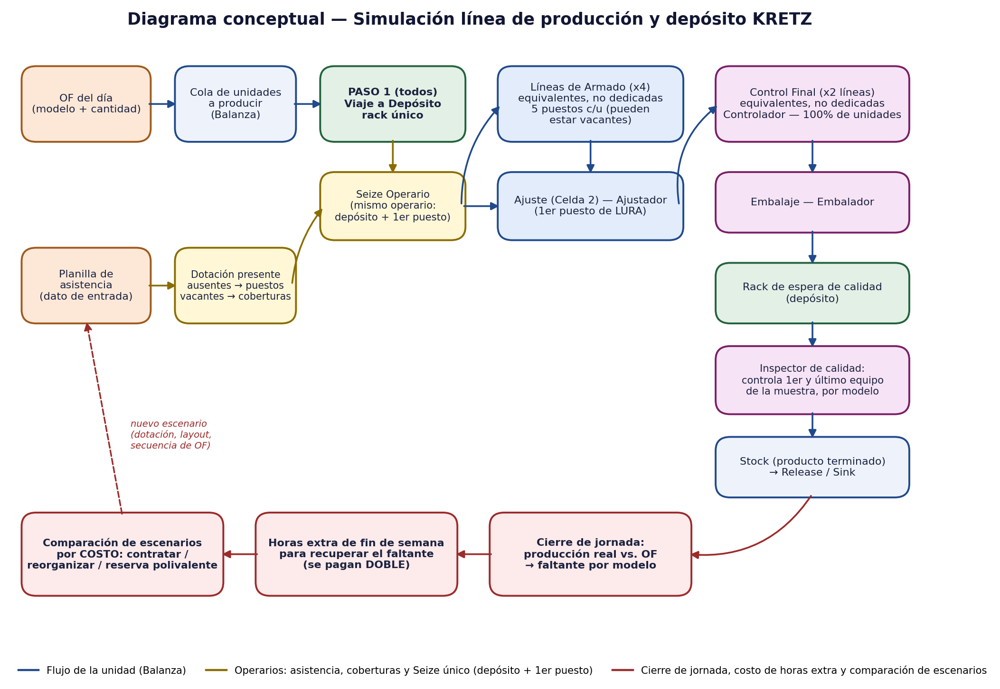

# Especificación del Modelo de Simulación

**Línea de producción y depósito — Fábrica de balanzas KRETZ**
Trabajo Práctico Integrador de Simulación — Etapa 1/2
Grupo 7

Este documento es la especificación del sistema a simular (Etapa 1/2), previa a la construcción del modelo ejecutable en AnyLogic (Etapa 2/2). Describe el sistema, sus componentes y las reglas de funcionamiento con el detalle necesario para que el modelo pueda construirse sin ambigüedades a partir de esta especificación.

---

## 1. Sistema seleccionado

Se simulan la línea de producción y el depósito de materiales de la planta de KRETZ, fabricante de balanzas industriales y comerciales. KRETZ fabrica una gama de modelos más amplia; **para esta simulación se eligieron 5 modelos representativos** (AILA 30KG, REPORT LT, NOVEL ECO, LURA y AURA). Cubren distintas gamas y distintos recorridos de proceso, incluido un equipo importado que llega ya armado.

La planta física tiene dos naves: una de producción (líneas de Armado y de Control Final) y otra de depósito (rack de materiales, racks de producto terminado y de espera de control de calidad). Las une una zona de circulación común.

| Nave                 | Dimensión aproximada | Uso                                                                                                         |
| -------------------- | -------------------- | ----------------------------------------------------------------------------------------------------------- |
| Planta de producción | 20 m × 25 m          | 6 líneas de producción (Armado y Control Final)                                                             |
| Depósito             | 22 m × 25 m          | Rack único de materiales de fabricación, rack de espera de control de calidad y racks de producto terminado |

## 2. Descripción del problema

La planta tiene **6 líneas de producción** (4 de Armado y 2 de Control Final), **con 5 puestos de trabajo cada una**. Las líneas no están dedicadas a un modelo de balanza: cualquier línea de Armado puede recibir cualquiera de los 5 equipos, y lo mismo pasa con las de Control Final. **Los puestos no están siempre ocupados**. Un puesto puede quedar sin operario porque falta alguien de la dotación o porque ese día hay ausencias. También puede quedar ocioso, con operario pero sin trabajo, porque el mix de equipos de la OF no lo necesita.

La producción de cada día responde a una **Orden de Fabricación (OF)** que indica qué equipos hay que producir y en qué cantidad. Los tiempos de proceso relevados de SAP son promedios, pero en la operación real varían. A eso se suman las ausencias del personal y la cantidad limitada de puestos. Como resultado, **hay días en que la OF no se cumple**. Hoy KRETZ recupera ese faltante con **horas extra los fines de semana, que se pagan al doble**, y eso representa un costo importante para la empresa.

El objetivo de la simulación es, por un lado, reproducir el funcionamiento de las jornadas de trabajo para medir cuándo y por qué no se llega a la OF. Por otro, **evaluar en términos de costo** si conviene contratar más empleados, reorganizar las áreas (redistribuir operarios, puestos o la secuencia de fabricación) o tener personal de reserva para cubrir ausencias. Todas estas alternativas se comparan contra el costo actual de las horas extra de fin de semana. Se simula con variabilidad, y no se calcula solo con la media, porque la variabilidad de los tiempos y las ausencias es justamente lo que produce los incumplimientos.

Hay tres aspectos centrales del problema:

- **Viaje a Depósito como primer paso de todos los equipos.** Antes de trabajar en un equipo, el operario que lo va a atender camina hasta el rack único de materiales del depósito, retira lo que necesita y después va a su primer puesto. Por eso los operarios se modelan como peatones (Pedestrian Library) y no como recursos abstractos: el tiempo de traslado entre naves es parte del tiempo real del proceso.
- **Ausentismo y coberturas.** A partir de la planilla de asistencia de los empleados se modela quién falta cada día. Cuando falta alguien, su puesto queda vacante y otro operario tiene que cubrirlo, dejando su propio puesto. El modelo tiene que mostrar qué pasa con la producción en ese caso, porque es un argumento directo a favor o en contra de tener más gente.
- **Control de calidad por muestreo.** Los equipos terminados esperan en un rack del depósito hasta el control de calidad. Por cada tipo de equipo fabricado en el día se toma una muestra, y el inspector controla solo el primer y el último equipo de esa muestra.

## 3. Límites del sistema

### Incluido en el alcance del modelo

- El flujo de cada unidad (Balanza) de los 5 modelos seleccionados. Arranca cuando se libera para producción según la OF y termina cuando pasa a stock, después del control de calidad.
- El viaje a Depósito para retirar materiales del rack único de fabricación, como **primer paso obligatorio de todos los equipos**.
- Las 6 líneas de producción (4 de Armado y 2 de Control Final) con sus 5 puestos cada una. Incluye el estado de cada puesto (ocupado, vacante u ocioso) y la asignación de cada unidad a una línea o puesto disponible (ruteo, porque las líneas no son exclusivas de un equipo).
- El desplazamiento peatonal de los operarios entre el depósito y los puestos de trabajo.
- **El ausentismo del personal**, a partir de la planilla de asistencia, y la **cobertura de puestos vacantes** por otros operarios.
- El rack de espera de calidad y la regla de muestreo (primer y último equipo de la muestra, por tipo de equipo).
- El cierre de jornada: comparación entre producción real y OF, cálculo de las **horas extra de fin de semana** necesarias para recuperar el faltante y su **costo** (al doble).
- La comparación económica entre escenarios: dotación actual con horas extra, contratación de personal, reorganización de áreas y personal de reserva polivalente.

### Fuera del alcance del modelo

- Los modelos de balanza que KRETZ fabrica y no fueron seleccionados para la simulación.
- La cadena de abastecimiento externa. Se asume que el rack de materiales siempre tiene stock para iniciar cualquier unidad de la OF (no se modela agotamiento de insumos ni reposición desde proveedores).
- La logística de despacho a clientes una vez que el producto terminado entra a stock.
- El mantenimiento y las fallas de máquinas o herramientas de los puestos.
- El retrabajo de los equipos rechazados en control de calidad (se registra el rechazo, pero no se simula la reparación).
- La generación administrativa de la OF (la OF es un dato de entrada, no una salida del modelo).

## 4. Entidades

| Entidad                           | Descripción                                                                                                         | Atributos principales                                                                                                                                                                      |
| --------------------------------- | ------------------------------------------------------------------------------------------------------------------- | ------------------------------------------------------------------------------------------------------------------------------------------------------------------------------------------ |
| Balanza                           | Unidad de producto que recorre el sistema desde el viaje a Depósito hasta el stock.                                 | modelo (AILA 30KG / REPORT LT / NOVEL ECO / LURA / AURA); línea y puestos asignados; hora de inicio y de fin; posición en la muestra de calidad; resultado del control (si se inspeccionó) |
| Orden de Fabricación (OF) del día | Define qué modelos hay que producir en la jornada y en qué cantidad.                                                | lista de (modelo, cantidad objetivo); fecha / día de la semana                                                                                                                             |
| Muestra de control de calidad     | Conjunto de unidades de un mismo modelo producidas en el día. De ella se inspeccionan el primer y el último equipo. | modelo; tamaño de la muestra; unidades acumuladas                                                                                                                                          |

## 5. Recursos

El recurso central es el **Operario**, modelado como agente peatón (Pedestrian Library). Tiene una especialidad (Armador, Ajustador, Controlador o Embalador), un puesto habitual y un estado de asistencia del día. Ocupa una posición física en la planta, camina entre el depósito y su puesto, y su desplazamiento consume tiempo de simulación.

| Recurso                           | Cantidad          | Detalle                                                                                                   |
| --------------------------------- | ----------------- | --------------------------------------------------------------------------------------------------------- |
| Líneas de Armado                  | 4                 | Equivalentes entre sí, con 5 puestos cada una. Cualquiera puede recibir cualquier modelo.                 |
| Líneas de Control Final           | 2                 | Equivalentes entre sí, con 5 puestos cada una. Incluyen los puestos de Control Final y de Embalaje.       |
| Puestos de trabajo                | 30 (6 líneas × 5) | No siempre ocupados: pueden estar vacantes (sin operario) u ociosos (sin trabajo).                        |
| Operarios de líneas de producción | ≈ 30              | Especializados en Ajustador, Controlador o Embalador. Los puestos de armado no requieren especialización. |
| Operarios de depósito             | ≈ 20              | Recepción, almacenamiento y despacho en el depósito.                                                      |
| Inspector de calidad              | 1                 | Hace el control de calidad por muestreo sobre el rack de espera.                                          |
| Rack único de fabricación         | 1                 | Punto físico único de retiro de materiales para los 5 modelos (no hay racks separados por equipo).        |
| Rack de espera de calidad         | 1                 | Donde los equipos embalados esperan el control de calidad antes de pasar a stock.                         |

Dotación total: **51 empleados**. Como hay tantos operarios de línea como puestos (≈ 30), cualquier ausencia deja un puesto vacante o fuerza una cobertura.

## 6. Procesos

### 6.1 Secuencia por modelo

**Todos los equipos empiezan con el viaje a Depósito (Secuencia 1)**: el operario camina hasta el rack único de fabricación, retira los materiales y va a su primer puesto. El tiempo de SAP de este paso (2 min) es **solo el tiempo de retiro de los materiales en el rack**: no incluye la caminata hasta el depósito ni el regreso al puesto, que salen de la simulación peatonal. Después, cada modelo sigue su propia secuencia de puestos y tiempos, relevada de SAP:

#### AILA 30KG

| Seq. | Etapa         | Celda         | Puesto / tarea                          | Especialidad | Tiempo medio (min) |
| ---- | ------------- | ------------- | --------------------------------------- | ------------ | ------------------ |
| 1    | Depósito      | Depósito      | Viaje a Depósito (retiro de materiales) | Armador      | 2                  |
| 2    | Armado        | Celda 1       | Armado Puesto 1                         | Armador      | 3,5                |
| 3    | Armado        | Celda 1       | Armado Puesto 2                         | Armador      | 7                  |
| 4    | Armado        | Celda 1       | Armado Puesto 3                         | Armador      | 7                  |
| 5    | Armado        | Celda 1       | Armado Puesto 4                         | Armador      | 7,5                |
| 6    | Armado        | Celda 2       | Ajuste                                  | Ajustador    | 5                  |
| 7    | Control Final | Control Final | Control Final                           | Controlador  | 4,5                |
| 8    | Control Final | Embalaje      | Embalaje                                | Embalador    | 10                 |

#### REPORT LT

| Seq. | Etapa         | Celda         | Puesto / tarea                               | Especialidad | Tiempo medio (min) |
| ---- | ------------- | ------------- | -------------------------------------------- | ------------ | ------------------ |
| 1    | Depósito      | Depósito      | Viaje a Depósito (retiro de materiales)      | Armador      | 2                  |
| 2    | Armado        | Celda 1       | Armado                                       | Armador      | 11                 |
| 3    | Armado        | Celda 3       | Ensamble final, calibrado y cierre de equipo | Ajustador    | 12                 |
| 4    | Control Final | Control Final | Control Final y metrológico                  | Controlador  | 12                 |
| 5    | Control Final | Embalaje      | Embalaje                                     | Embalador    | 12                 |

#### NOVEL ECO

| Seq. | Etapa         | Celda         | Puesto / tarea                          | Especialidad | Tiempo medio (min) |
| ---- | ------------- | ------------- | --------------------------------------- | ------------ | ------------------ |
| 1    | Depósito      | Depósito      | Viaje a Depósito (retiro de materiales) | Armador      | 2                  |
| 2    | Armado        | Celda 1       | Armado                                  | Armador      | 3,15               |
| 3    | Armado        | Celda 2       | Ajuste                                  | Ajustador    | 3                  |
| 4    | Control Final | Control Final | Control Final                           | Controlador  | 2,25               |
| 5    | Control Final | Embalaje      | Embalaje                                | Embalador    | 3                  |

#### LURA

| Seq. | Etapa         | Celda         | Puesto / tarea                          | Especialidad | Tiempo medio (min) |
| ---- | ------------- | ------------- | --------------------------------------- | ------------ | ------------------ |
| 1    | Depósito      | Depósito      | Viaje a Depósito (retiro de materiales) | Ajustador    | 2                  |
| 2    | Armado        | Celda 2       | Ajuste                                  | Ajustador    | 4                  |
| 3    | Control Final | Control Final | Control Final                           | Controlador  | 3,15               |
| 4    | Control Final | Embalaje      | Embalaje                                | Embalador    | 3,15               |

#### AURA

| Seq. | Etapa         | Celda         | Puesto / tarea                          | Especialidad | Tiempo medio (min) |
| ---- | ------------- | ------------- | --------------------------------------- | ------------ | ------------------ |
| 1    | Depósito      | Depósito      | Viaje a Depósito (retiro de materiales) | Armador      | 2                  |
| 2    | Armado        | Celda 1       | Armado                                  | Armador      | 3,15               |
| 3    | Armado        | Celda 2       | Ajuste                                  | Ajustador    | 3                  |
| 4    | Control Final | Control Final | Control Final                           | Controlador  | 2,5                |
| 5    | Control Final | Embalaje      | Embalaje                                | Embalador    | 2,88               |

### 6.2 Viaje a Depósito (común a todos los equipos)

El viaje a Depósito lo hace siempre **el mismo operario que va a ejecutar el primer puesto del equipo**. Es un Armador en AILA 30KG, REPORT LT, NOVEL ECO y AURA, y un Ajustador en LURA, porque LURA llega armado desde origen y no pasa por Celda 1. No hay una dotación de depósito dedicada a esta tarea.

**Qué incluye el tiempo de SAP:** los 2 minutos relevados son solo el tiempo aproximado de retiro de los materiales en el rack. No incluyen el tiempo de ir desde el puesto hasta el depósito ni el de volver al primer puesto. Esos traslados los calcula el modelo con la distancia real recorrida y la velocidad peatonal del operario. El tiempo total del paso 1 es entonces: caminata hasta el depósito + 2 min de retiro en el rack + caminata hasta el primer puesto.

Para garantizar que sea el mismo operario, el paso se modela como un único *Seize* del operario, seguido de un *Delay* en el depósito (solo los 2 min de retiro; la caminata la resuelve el movimiento peatonal) y otro *Delay* en el primer puesto (uno por cada ubicación física). El *Release* va al final. Nunca se modela como dos bloques de servicio independientes, porque eso podría asignar el traslado y la tarea a dos operarios distintos.

### 6.3 Ruteo entre líneas equivalentes

Ninguna de las 4 líneas de Armado ni de las 2 de Control Final está dedicada a un modelo. Por eso el modelo decide en ejecución a qué línea o puesto disponible dirigir cada unidad, según qué puestos tienen operario presente y libre, en lugar de seguir un camino fijo equipo→línea.

### 6.4 Asistencia, puestos vacantes y coberturas

1. **Inicio de jornada:** se determina qué empleados están presentes, a partir de las probabilidades de ausencia que surgen de la planilla de asistencia.
2. **Puesto vacante:** el puesto habitual de cada ausente queda vacante y no puede procesar unidades mientras nadie lo cubra.
3. **Cobertura:** un operario presente cubre el puesto vacante según una regla de prioridad. Primero lo cubre alguien de la misma especialidad y de la misma línea, después alguien de la misma especialidad de otra línea. Los puestos de armado los puede cubrir cualquier operario. Quien cubre deja su propio puesto, así que la cobertura traslada el cuello de botella en vez de eliminarlo.
4. **Registro:** se registran la cantidad de coberturas, los puestos que quedaron sin cubrir y el tiempo que cada puesto pasó vacante, para medir cuánta producción se pierde por ausentismo.

### 6.5 Control de calidad por muestreo

Después del Control Final (que el Controlador hace sobre el 100% de las unidades, con los tiempos de SAP) y del Embalaje, cada equipo va al **rack de espera de calidad** del depósito. Por cada tipo de equipo fabricado en el día se arma una muestra con la producción de ese tipo. El inspector de calidad controla **solo el primer y el último equipo de esa muestra**. El resto pasa a stock sin inspección. Esto se repite por separado para cada modelo de la OF del día.

### 6.6 Cierre de jornada y costo del faltante

Al terminar el turno se compara, por modelo y en total, la cantidad efectivamente terminada con la cantidad pedida por la OF. Si hay faltante, se simula una **jornada de recuperación de fin de semana** cuya OF es el faltante, con la dotación que trabajaría ese día. De esa jornada se mide cuántas horas-hombre hacen falta para completarlo, y esas horas se valorizan **al doble del valor de la hora normal**. Se pueden encadenar varias jornadas (por ejemplo, una semana de lunes a viernes) para acumular el faltante semanal que se recupera el fin de semana.

### 6.7 Evaluación de escenarios

Cada escenario (dotación actual, más empleados de una especialidad, reorganización de áreas o puestos, personal de reserva polivalente, cambio en la secuencia de la OF) se corre varias veces, porque tiempos y ausencias son aleatorios. En cada escenario se compara el **costo total**: horas normales, más horas extra de fin de semana al doble, más el costo de las contrataciones o de la reorganización.

## 7. Colas

- **Cola de unidades liberadas por la OF:** unidades esperando que haya un operario disponible para iniciar el viaje a Depósito y su primer puesto. Es FIFO dentro de cada modelo, salvo que un escenario defina otra prioridad de secuenciación.
- **Cola en el rack de depósito:** el rack de materiales es único para los 5 modelos, así que los operarios que van a retirar material pueden coincidir y esperar turno.
- **Colas por puesto:** cada celda de Armado, Ajuste, Control Final y Embalaje acumula unidades mientras su operario está ocupado **o mientras el puesto está vacante sin cobertura**. Son FIFO con capacidad ilimitada.
- **Cola en el rack de espera de calidad:** equipos embalados esperando el control del inspector, o el paso a stock si no forman parte de la inspección.

## 8. Variables

| Variable                                | Tipo              | Descripción                                                                        |
| --------------------------------------- | ----------------- | ---------------------------------------------------------------------------------- |
| Producción acumulada por modelo         | Entera, dinámica  | Unidades terminadas en la jornada, por modelo                                      |
| Faltante por modelo                     | Entera, calculada | Cantidad pedida por la OF menos la producción acumulada, al cierre                 |
| Empleados ausentes del día              | Entera, aleatoria | Cantidad (y cuáles) de operarios ausentes, según la planilla de asistencia         |
| Puestos vacantes                        | Entera, dinámica  | Puestos sin operario en cada instante (sin cubrir)                                 |
| Coberturas realizadas                   | Entera, acumulada | Cantidad de veces que un operario dejó su puesto para cubrir otro                  |
| Tiempo de puesto vacante                | Continua          | Minutos que cada puesto estuvo sin operario durante la jornada                     |
| Ocupación de operarios por especialidad | Continua [0,1]    | Fracción del turno en que cada especialidad está trabajando o caminando            |
| Longitud de cola por puesto             | Entera, dinámica  | Unidades esperando en cada puesto en un instante dado                              |
| Tiempo de traslado acumulado            | Continua          | Tiempo total que los operarios pasan caminando entre depósito y puestos            |
| Horas extra de fin de semana requeridas | Continua          | Horas-hombre necesarias para recuperar el faltante                                 |
| Costo de horas extra                    | Continua ($)      | Horas extra × valor hora × 2                                                       |
| Costo total del escenario               | Continua ($)      | Horas normales + horas extra + contrataciones / reorganización                     |
| Resultado del muestreo de calidad       | Categórica        | Aprobado o rechazado, para el primer y el último equipo de cada muestra por modelo |

## 9. Parámetros

- **Tiempos de tarea:** tiempos medios por modelo, celda y puesto, según `Datos/tiempos_proceso.csv`. Se usan como parámetro de una distribución estadística por tarea, no como valor fijo.
- **Estructura de planta:** 6 líneas (4 de Armado y 2 de Control Final), con 5 puestos cada una.
- **Dotación:** operarios por especialidad y por línea (51 empleados en total, incluido 1 inspector de calidad). Es la variable de decisión de los escenarios de contratación.
- **Ausentismo:** probabilidad de ausencia por empleado, especialidad o día de la semana, estimada a partir de la planilla de asistencia.
- **Regla de cobertura:** qué especialidades pueden cubrir qué puestos, y en qué orden de prioridad.
- **OF del día:** modelos y cantidades objetivo (al menos 2 o 3 ejemplos de OF real para comparar escenarios).
- **Muestra de calidad:** tamaño de la muestra por tipo de equipo producido en el día.
- **Desplazamiento:** velocidad peatonal de los operarios y ubicación de los nodos base (home location) de cada puesto.
- **Jornada:** duración del turno normal y de la jornada de recuperación de fin de semana.
- **Costos:** valor de la hora normal por especialidad; recargo de fin de semana (**factor 2**, se paga el doble); costo de incorporar un empleado (sueldo más cargas, prorrateado al horizonte simulado); costo de una reorganización de áreas o puestos.

## 10. Eventos

| Evento                                         | Descripción                                                                                          |
| ---------------------------------------------- | ---------------------------------------------------------------------------------------------------- |
| Inicio de jornada                              | Se carga la OF del día y se determina la asistencia de cada empleado.                                |
| Ausencia de un empleado                        | El puesto habitual del ausente queda vacante.                                                        |
| Cobertura de un puesto                         | Un operario presente deja su puesto para cubrir uno vacante, según la regla de cobertura.            |
| Liberación de una unidad                       | Una unidad de la OF queda disponible para iniciar su secuencia.                                      |
| Llegada del operario al depósito / a un puesto | El operario (peatón) termina su desplazamiento al rack o al puesto asignado.                         |
| Fin de tarea en un puesto                      | Termina el tiempo de servicio de un puesto y la unidad sigue su secuencia.                           |
| Ingreso al rack de espera de calidad           | Un equipo embalado llega al rack. Se decide si es el primero o el último de la muestra de su modelo. |
| Inspección de calidad                          | El inspector controla el equipo seleccionado, que pasa a stock (o se registra como rechazado).       |
| Cierre de jornada                              | Termina el turno. Se congelan los contadores y se calcula el faltante contra la OF.                  |
| Jornada de recuperación de fin de semana       | Se produce el faltante acumulado y se registran las horas extra y su costo.                          |

## 11. Estados

- **Puesto de trabajo:** ocupado y trabajando / ocupado y ocioso (sin unidades para procesar) / vacante (sin operario) / cubierto por otro operario.
- **Operario:** ausente / presente y libre / caminando al depósito o a un puesto / trabajando en su puesto / cubriendo otro puesto.
- **OF del día:** para cada modelo, cantidad pedida, cantidad producida y cantidad pendiente.
- **Rack de fabricación:** libre u ocupado por un operario que retira material (se asume que siempre hay stock de materiales).
- **Muestra de calidad por modelo:** unidades producidas respecto del tamaño de la muestra, para saber si la próxima es la primera, la última o ninguna.
- **Semana (si se encadenan jornadas):** faltante acumulado a recuperar el fin de semana.

## 12. Relaciones entre componentes

**Flujo de la unidad.** La OF del día alimenta la cola de unidades a producir, y el modelo de cada unidad determina su secuencia de puestos y tiempos. Todas empiezan por el viaje a Depósito. El operario que atiende la unidad se toma de un *ResourcePool* de su especialidad, cuyo agente es de tipo Operario (peatón). Ese mismo operario queda asignado con un único *Seize* durante todo el tramo depósito→primer puesto.

**Disponibilidad de operarios.** La planilla de asistencia define qué operarios están presentes al inicio de la jornada. Eso determina qué puestos están vacantes y qué coberturas hacen falta, y por lo tanto qué capacidad real tiene cada línea ese día. El componente de ruteo usa esa disponibilidad para asignar cada unidad a una de las líneas equivalentes.

**Calidad y stock.** Después del Control Final y el Embalaje, la unidad pasa al rack de espera de calidad. Ahí el componente de muestreo decide si la inspecciona el inspector, y luego la unidad pasa a stock.

**Cierre y costos.** Cada unidad terminada suma al contador de producción de su modelo. El cierre de jornada lo compara con la OF y, si hay faltante, calcula las horas extra de fin de semana y su costo. Ese costo es la base para comparar los escenarios de contratación, reorganización y personal de reserva. Cada escenario, a su vez, modifica los parámetros de dotación, layout o secuencia de entrada del modelo (ver diagrama, sección 17).

## 13. Datos de entrada

- `Datos/tiempos_proceso.csv`**:** una fila por paso de proceso y equipo (Equipo, Secuencia, Linea_tipo, Celda, Puesto, Tarea, Tiempo_min, Tiempo_seg, Cantidad_operarios, Nota). El paso 1 de los 5 equipos es el viaje a Depósito (Linea_tipo = Deposito); su Tiempo_min es solo el retiro en el rack, sin los traslados. Es la fuente de las secuencias y los tiempos medios de la sección 6.
- **Planilla de asistencia de los empleados:** registro de presencias y ausencias. Con ella se estima la probabilidad de ausencia por empleado, especialidad y día de la semana, y la frecuencia de ausencias simultáneas.
- `Datos/dotacion_lineas.csv`**:** dotación y especializaciones por línea. 

- Ejemplos concretos de OF real para comparar corridas.
- **Datos de costo:** valor de la hora, costo total de un empleado adicional (sueldo más cargas) y costo estimado de reorganizar áreas o puestos.
- Historial de horas extra de fin de semana trabajadas y pagadas.
- Ubicación del rack de fabricación, del rack de espera de calidad y de cada puesto sobre el plano a escala.

## 14. Indicadores de desempeño

| Indicador                                       | Qué mide                                                                                                 |
| ----------------------------------------------- | -------------------------------------------------------------------------------------------------------- |
| % de cumplimiento de la OF (por modelo y total) | Producción real / cantidad pedida, al cierre de la jornada                                               |
| Unidades faltantes por modelo y por línea       | Dónde se concentra el incumplimiento                                                                     |
| Horas extra de fin de semana requeridas         | Horas-hombre necesarias para recuperar el faltante                                                       |
| **Costo de horas extra**                        | Horas extra × valor hora × 2                                                                             |
| **Costo total por escenario**                   | Horas normales + horas extra + contrataciones / reorganización, para comparar alternativas               |
| **Ahorro neto frente al escenario actual**      | Diferencia de costo total entre cada alternativa y la situación actual (dotación actual con horas extra) |
| Producción perdida por ausentismo               | Diferencia de producción entre jornadas con y sin ausencias, y tiempo de puestos vacantes                |
| Coberturas por jornada                          | Cuántas veces hubo que mover un operario para cubrir un puesto, y qué puesto quedó descubierto           |
| Utilización de operarios por especialidad       | % del turno ocupado (trabajando o caminando) frente a libre u ocioso                                     |
| Tiempo de espera en cola por puesto             | Tiempo medio y máximo de espera en cada puesto (identifica cuellos de botella)                           |
| Tiempo total en sistema por modelo              | Desde el viaje a Depósito hasta el ingreso a stock                                                       |
| Tiempo de traslado peatonal                     | Fracción del tiempo de los operarios que se va en desplazamientos                                        |
| Tasa de rechazo en la muestra de calidad        | % de equipos inspeccionados que no aprueban, por modelo                                                  |

## 15. Supuestos

- Los 5 modelos seleccionados son representativos de la carga de la planta. Durante la jornada simulada, las líneas solo procesan la OF de esos 5 modelos.
- El rack único de materiales nunca se queda sin stock durante la jornada.
- La asistencia se determina al inicio de la jornada.
- Las probabilidades de ausencia de la planilla de asistencia histórica son representativas de lo que va a pasar en las jornadas simuladas.
- Los tiempos de SAP son valores medios. La variabilidad real de cada tarea se aproxima con una distribución estadística a definir a partir de esos promedios.
- El tiempo de SAP del viaje a Depósito (2 min) corresponde solo al retiro de materiales en el rack. Los traslados de ida y vuelta surgen de la simulación peatonal.
- El operario que hace el viaje a Depósito para una unidad es siempre el mismo que ejecuta el primer puesto de esa unidad, cualquiera sea su especialidad.
- El Control Final lo hace el Controlador sobre el 100% de las unidades. El inspector de calidad inspecciona solo el primer y el último equipo de la muestra de cada modelo.
- La jornada de fin de semana rinde lo mismo por hora que una jornada normal. Solo cambia el costo de la hora (factor 2).

## 16. Preguntas de simulación

- ¿Con la dotación y la organización actuales, cuántas jornadas no se cumple la OF? ¿En qué equipos, líneas o puestos se concentra el faltante?
- ¿Cuántas horas extra de fin de semana se necesitan para recuperar ese faltante y **cuánto cuestan**, pagadas al doble?
- ¿**Conviene en costo contratar más empleados** que seguir pagando horas extra de fin de semana? ¿Cuántos y de qué especialidad (Ajustador, Controlador, Embalador), o en qué línea?
- ¿**Conviene reorganizar las áreas** (redistribuir operarios entre líneas o puestos, ampliar o agregar puestos) para cumplir la OF sin contratar? ¿Cuánto se ahorra frente al escenario actual?
- ¿Conviene tener personal de reserva para cubrir ausencias, en vez de pagar horas extra?
- ¿Conviene cambiar el orden o la prioridad de fabricación dentro del día (por ejemplo, empezar por los equipos con procesos más largos) para evitar faltantes?

## 17. Diagrama conceptual final

El esquema resume el patrón común a los 5 modelos:

1. Una unidad se libera según la OF del día.
2. Todas empiezan con el viaje a Depósito. El mismo operario retira los materiales y sigue hasta su primer puesto.
3. La unidad se asigna a una de las líneas equivalentes de Armado, o va directo a Ajuste en el caso de LURA.
4. Pasa por Control Final y Embalaje, espera en el rack de calidad (donde se inspeccionan el primer y el último equipo de cada muestra) y entra a stock.

La disponibilidad de operarios sale de la planilla de asistencia (ausencias, puestos vacantes y coberturas). Al cierre, el faltante se traduce en horas extra de fin de semana al doble. Ese costo se usa para comparar los escenarios, y cada escenario vuelve a alimentar el modelo con otra dotación, layout o secuencia.

